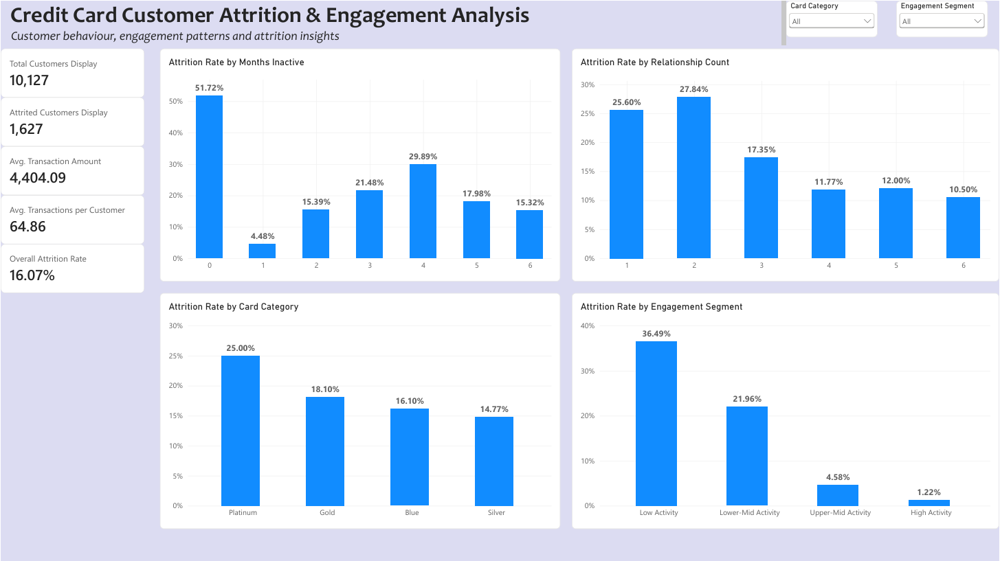
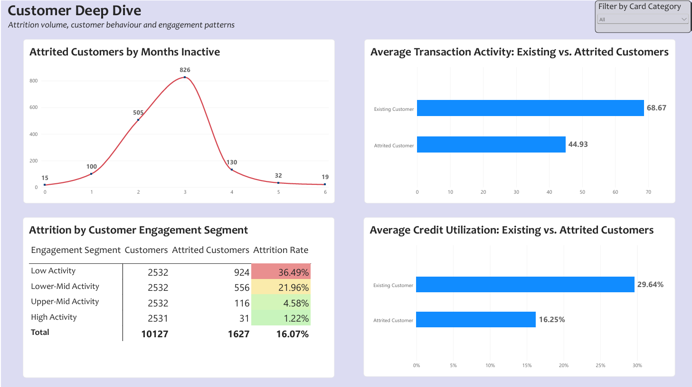
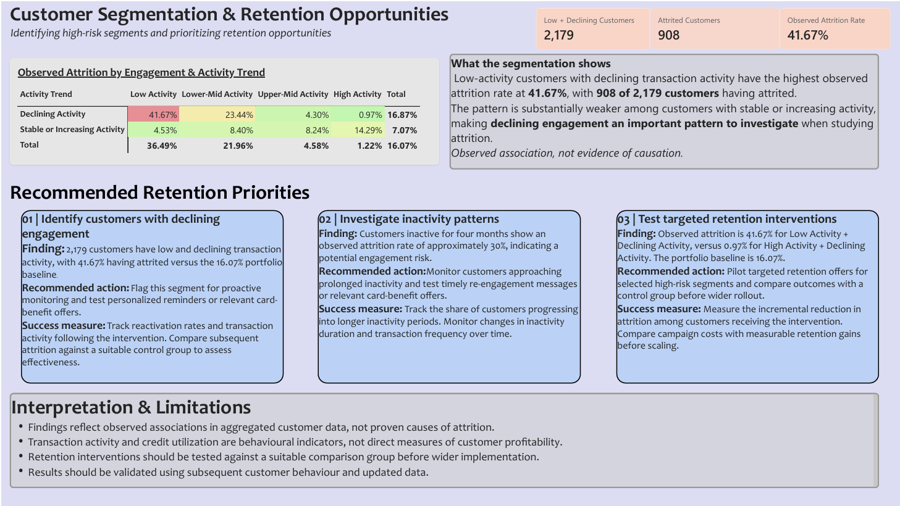

# Credit Card Customer Attrition & Engagement Analytics

An interactive data analytics project exploring credit card customer attrition, transaction behaviour, inactivity patterns, and engagement segments using SQL, PostgreSQL, and Power BI.

## Project Overview

The objective is to identify customer groups with elevated observed attrition, understand behavioural patterns associated with attrition, and highlight opportunities for further investigation and retention testing.

## Tools & Technologies

- **PostgreSQL / SQL:** Data analysis, aggregations, customer segmentation, and analytical views
- **Power BI Desktop:** Interactive dashboards, KPIs, and visual analysis
- **DAX:** Attrition-rate calculations and report measures

## Dashboard Preview

### 1. Executive Overview

Portfolio KPIs and observed attrition patterns across inactivity periods, relationship counts, card categories, and engagement segments.

### 2. Customer Deep Dive

Comparison of transaction activity and credit utilization between existing and attrited customers, alongside attrition volumes and engagement-segment analysis.

### 3. Customer Segmentation & Retention Opportunities

Engagement and activity-trend segmentation, identification of high-attrition groups, and proposed retention priorities.

## Key Findings

- **Portfolio size:** 10,127 customers.
- **Attrited customers:** 1,627.
- **Overall observed attrition rate:** 16.07%.
- **Priority segment:** 2,179 customers classified as Low Activity with Declining Activity.
- **Priority-segment attrition:** 908 customers, representing an observed attrition rate of 41.67%.
- **Average transaction activity:** Existing customers averaged 68.67 transactions, compared with 44.93 for attrited customers.

## Business Recommendations

1. Monitor customers with low and declining transaction activity.
2. Investigate inactivity patterns and opportunities for re-engagement.
3. Test targeted retention interventions against a suitable control group before broader implementation.

## Methodology & Limitations

The analysis identifies associations in aggregated customer data. It does not establish causation, guarantee retention outcomes, or directly measure customer profitability. Proposed interventions require further testing and validation using subsequent customer behaviour.

## Project Files

- `Credit_Card_Portfolio_Analytics.pbix` — Interactive Power BI report.
- `screenshots/` — Dashboard page previews.
- `sql/` — SQL scripts and analytical views, to be added.

## How to View

Download the `.pbix` file from this repository and open it in Power BI Desktop. Data-source configuration may be required to refresh the report.
